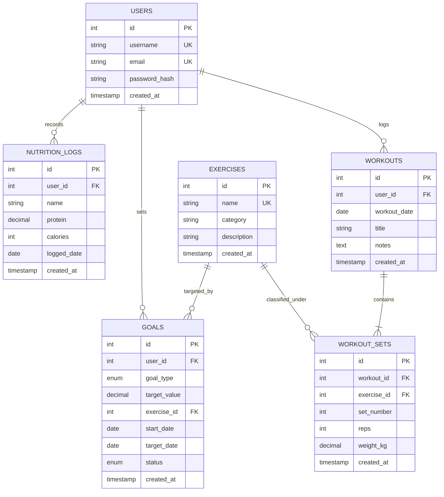

# Fitness Tracker

> An intermediate full-stack fitness and workout tracking web application designed specifically to showcase **advanced SQL design, normalization, relational integrity, ACID transactions, and analytical queries** for technical interviews.

---

## 🛠 Tech Stack

| Layer | Technology | Key Details |
| :--- | :--- | :--- |
| **Frontend** | React 19 + Vite | JavaScript (no TypeScript, no Redux, no Tailwind) |
| **Data Viz** | Recharts | Weekly volume bars, workout frequency, progression lines |
| **Backend** | FastAPI (Python 3.12) | RESTful API, asynchronous performance, automatic Swagger docs |
| **Database ORM** | SQLAlchemy 2.0 + PyMySQL | ORM used for basic CRUD; raw SQL used for analytics |
| **Database** | MySQL 8.0+ | InnoDB engine, normalized to 3NF, constraints, and views |
| **Authentication** | JWT (PyJWT) + Bcrypt | Salted password hashing, bearer token authorization |

---

## 📐 Database Architecture & Schema Explanation

The schema is defined in [`backend/schema.sql`](backend/schema.sql), which acts as the **single source of truth** for all tables, constraints, indexes, and views. The SQLAlchemy models in [`backend/models.py`](backend/models.py) mirror it exactly.

### Entity-Relationship Diagram



### Table Design Decisions

1. **`users`**:
   - `id` (PK, Auto-Increment), unique `username` and `email`.
   - `password_hash` stores 60-character salted bcrypt hashes.

2. **`exercises`**:
   - Master catalog of exercises categorized by muscle group (`Chest`, `Back`, `Legs`, `Shoulders`, `Arms`, `Core`).
   - Indexed on `category` for fast category-filtered PR queries.

3. **`workouts`**:
   - Represents a workout session performed on a specific `workout_date`.
   - Foreign key to `users(id)` with `ON DELETE CASCADE`.
   - **Composite Index**: `idx_workouts_user_date (user_id, workout_date)` ensures rapid filtering of a user's chronological workouts.

4. **`workout_sets`**:
   - Set-level breakdown (`set_number`, `reps`, `weight_kg`).
   - **Unique Constraint**: `UNIQUE (workout_id, exercise_id, set_number)` prevents recording duplicate set numbers for the same exercise in a session.
   - **CHECK Constraints**: `reps > 0`, `weight_kg >= 0`, `set_number > 0` enforce data sanity at the database engine level.
   - Foreign key to `exercises(id)` uses `ON DELETE RESTRICT` to preserve historical integrity.
   - **Composite Index**: `idx_sets_exercise_weight (exercise_id, weight_kg)` accelerates peak weight lookups for personal records.

5. **`goals`**:
   - Tracks user fitness objectives (`weekly_workouts` frequency or `exercise_weight` 1RM target).
   - Constraint `target_value > 0`.
   - Optional `exercise_id` with `ON DELETE SET NULL`.

6. **`nutrition_logs`**:
   - Preserves and persists the food tracker from the original frontend into MySQL (`name`, `protein`, `calories`, `logged_date`).

7. **SQL View: `weekly_summary`**:
   - Encapsulates multi-table aggregation across `workouts` and `workout_sets`.
   - Groups by `user_id` and Monday of each week using `DATE_SUB(workout_date, INTERVAL WEEKDAY(workout_date) DAY)` to avoid New Year split-week bugs.

---

## 🔍 Core SQL Queries Explained in Plain English

The analytics endpoints in [`backend/routers/analytics.py`](backend/routers/analytics.py) execute **raw SQL queries** via SQLAlchemy's `text()` function with parameterized bindings to demonstrate interview-level SQL mastery.

### 1. Weekly Volume & Workout Aggregation (SQL View)

```sql
SELECT 
    week_start_date,
    total_workouts,
    total_sets,
    total_reps,
    total_volume_kg
FROM weekly_summary
WHERE user_id = :user_id
ORDER BY week_start_date ASC
LIMIT :limit;
```

* **What it does**: Queries the `weekly_summary` view to extract weekly training volume (tonnage in kg = $\sum \text{reps} \times \text{weight}$) and workout frequency.
* **Why it matters**: Demonstrates the use of SQL Views to encapsulate complex aggregation logic (`LEFT JOIN`, `GROUP BY`, and `WEEKDAY` calculation) into a reusable reporting table.

---

### 2. All-Time Personal Records (Window Function: `ROW_NUMBER()`)

```sql
WITH ranked_sets AS (
    SELECT 
        e.id AS exercise_id,
        e.name AS exercise_name,
        e.category AS exercise_category,
        s.weight_kg,
        s.reps,
        w.workout_date,
        ROUND(s.weight_kg * (1.0 + s.reps / 30.0), 2) AS estimated_1rm,
        ROW_NUMBER() OVER (
            PARTITION BY e.id 
            ORDER BY s.weight_kg DESC, s.reps DESC, w.workout_date DESC
        ) AS rank_num
    FROM workout_sets s
    JOIN workouts w ON s.workout_id = w.id
    JOIN exercises e ON s.exercise_id = e.id
    WHERE w.user_id = :user_id
)
SELECT 
    exercise_id,
    exercise_name,
    exercise_category,
    weight_kg AS pr_weight_kg,
    reps AS pr_reps,
    workout_date AS pr_date,
    estimated_1rm
FROM ranked_sets
WHERE rank_num = 1
ORDER BY exercise_category ASC, exercise_name ASC;
```

* **Plain English Explanation**:
  1. The **Common Table Expression (CTE)** `ranked_sets` joins sets, workouts, and exercises for the user.
  2. The window function `ROW_NUMBER() OVER (PARTITION BY e.id ORDER BY s.weight_kg DESC, s.reps DESC, w.workout_date DESC)` assigns a ranking to every set per exercise. The heaviest lift gets rank 1; ties in weight are broken by the higher reps, and then by the newest date.
  3. The outer query filters `WHERE rank_num = 1`, pulling only the single all-time peak lift for each exercise.
  4. Also computes an estimated 1-Rep Max (1RM) using the Epley formula: $\text{weight} \times (1 + \frac{\text{reps}}{30})$.

---

### 3. Progressive Overload & Weight Deltas (Window Function: `LAG()`)

```sql
WITH session_summaries AS (
    SELECT 
        w.workout_date,
        MAX(s.weight_kg) AS top_weight_kg,
        ROUND(SUM(s.reps * s.weight_kg), 2) AS session_volume,
        COUNT(s.id) AS total_sets
    FROM workouts w
    JOIN workout_sets s ON w.id = s.workout_id
    WHERE w.user_id = :user_id AND s.exercise_id = :exercise_id
    GROUP BY w.id, w.workout_date
)
SELECT 
    workout_date,
    top_weight_kg,
    session_volume,
    total_sets,
    LAG(top_weight_kg, 1) OVER (ORDER BY workout_date ASC) AS prev_weight_kg,
    ROUND(top_weight_kg - COALESCE(LAG(top_weight_kg, 1) OVER (ORDER BY workout_date ASC), top_weight_kg), 2) AS weight_diff
FROM session_summaries
ORDER BY workout_date ASC;
```

* **Plain English Explanation**:
  1. Computes the peak weight lifted for a specific exercise during each workout session.
  2. Uses `LAG(top_weight_kg, 1) OVER (ORDER BY workout_date ASC)` to look backward one row in the ordered timeline to retrieve the weight lifted in the previous session.
  3. Subtracts `prev_weight_kg` from `top_weight_kg` to calculate the exact weight delta ($+2.5\text{kg}$, $+5\text{kg}$, etc.), showing progressive overload without requiring expensive self-joins.

---

### 4. Workout Streaks (The "Gaps & Islands" SQL Problem)

```sql
WITH user_dates AS (
    SELECT DISTINCT workout_date
    FROM workouts
    WHERE user_id = :user_id
),
numbered_dates AS (
    SELECT 
        workout_date,
        DATE_SUB(workout_date, INTERVAL ROW_NUMBER() OVER (ORDER BY workout_date ASC) DAY) AS island_id
    FROM user_dates
),
streak_islands AS (
    SELECT 
        MIN(workout_date) AS streak_start,
        MAX(workout_date) AS streak_end,
        COUNT(*) AS streak_days
    FROM numbered_dates
    GROUP BY island_id
)
SELECT 
    streak_start,
    streak_end,
    streak_days
FROM streak_islands
ORDER BY streak_end DESC;
```

* **Plain English Explanation**:
  1. **Step 1 (`user_dates`)**: Pulls distinct calendar dates on which the user worked out.
  2. **Step 2 (`numbered_dates`)**: Assigns a sequential row number (`1, 2, 3...`) to each date ordered chronologically. Then subtracts that row number in days from the date:
     $$\text{island\_id} = \text{workout\_date} - \text{ROW\_NUMBER}() \text{ days}$$
     **The Key Insight**: If a user works out on consecutive calendar days (e.g., Nov 2, Nov 3, Nov 4), the `workout_date` advances by 1 day and `ROW_NUMBER()` also advances by 1. Therefore, subtracting them produces the exact same `island_id` date! When a day is missed (a gap), `workout_date` skips ahead but `ROW_NUMBER()` only increases by 1, which shifts the difference to a new `island_id`.
  3. **Step 3 (`streak_islands`)**: Grouping by `island_id` condenses each unbroken streak into a single row with `COUNT(*) AS streak_days`.
  4. Evaluates `MAX(streak_days)` for the all-time record, and checks if the latest island's `streak_end` includes today or yesterday for the active streak.

---

### 5. Dynamic Goal Progress (Correlated Subqueries & Conditional Aggregation)

```sql
SELECT 
    g.id AS goal_id,
    g.goal_type,
    CAST(g.target_value AS DECIMAL(10,2)) AS target_value,
    g.start_date,
    g.target_date,
    g.status,
    e.id AS exercise_id,
    e.name AS exercise_name,
    CASE 
        WHEN g.goal_type = 'exercise_weight' THEN (
            SELECT COALESCE(MAX(s.weight_kg), 0.00)
            FROM workout_sets s
            JOIN workouts w ON s.workout_id = w.id
            WHERE w.user_id = g.user_id AND s.exercise_id = g.exercise_id
        )
        WHEN g.goal_type = 'weekly_workouts' THEN (
            SELECT COUNT(DISTINCT w.id)
            FROM workouts w
            WHERE w.user_id = g.user_id 
              AND w.workout_date >= DATE_SUB(CURDATE(), INTERVAL WEEKDAY(CURDATE()) DAY)
        )
        ELSE 0.00
    END AS current_value
FROM goals g
LEFT JOIN exercises e ON g.exercise_id = e.id
WHERE g.user_id = :user_id
ORDER BY g.status ASC, g.id DESC;
```

* **Plain English Explanation**:
  * Instead of maintaining redundant `current_value` columns that can drift out of sync, progress is computed live using `CASE WHEN`:
    * For `exercise_weight`, an inline correlated subquery finds the maximum weight ever lifted for that exercise.
    * For `weekly_workouts`, an inline correlated subquery counts distinct workouts performed since the Monday of the current week.

---

### 6. Atomic Transaction Management (ACID)

In [`backend/routers/workouts.py`](backend/routers/workouts.py), creating a workout with multiple sets uses explicit transaction boundaries:

```python
try:
    new_workout = models.Workout(user_id=current_user.id, workout_date=workout_in.workout_date, title=workout_in.title)
    db.add(new_workout)
    db.flush()  # Generates new_workout.id

    for s in workout_in.sets:
        # Validates exercise existence and constraints
        new_set = models.WorkoutSet(workout_id=new_workout.id, exercise_id=s.exercise_id, ...)
        db.add(new_set)

    db.commit()  # Commits all sets and header together
except Exception as e:
    db.rollback()  # Aborts entire transaction on error
    raise HTTPException(status_code=400, detail=str(e))
```

* **Why it matters**: Guarantees database **Atomicity**. If set #4 violates a constraint (e.g. invalid exercise ID or negative reps), the entire workout is rolled back, leaving zero orphaned workout headers.

---

## 📡 API Endpoint Reference

| Method | Endpoint | Description | Protected |
| :--- | :--- | :--- | :---: |
| **POST** | `/api/auth/register` | Registers a new user and returns JWT | No |
| **POST** | `/api/auth/login` | JSON login for React UI (returns JWT) | No |
| **POST** | `/api/auth/token` | Form-encoded login for Swagger `/docs` | No |
| **GET** | `/api/auth/me` | Returns current user profile | Yes |
| **GET** | `/api/exercises` | List exercise catalog grouped by category | No |
| **POST** | `/api/exercises` | Create a custom exercise | Yes |
| **GET** | `/api/workouts` | List workouts for authenticated user | Yes |
| **POST** | `/api/workouts` | **Atomic transaction**: create workout with sets | Yes |
| **GET** | `/api/workouts/{id}` | Get workout details (user isolated) | Yes |
| **DELETE**| `/api/workouts/{id}` | Delete workout session and cascade sets | Yes |
| **GET** | `/api/analytics/weekly-stats` | **Raw SQL View**: weekly volume and workouts | Yes |
| **GET** | `/api/analytics/personal-records` | **Raw SQL Window Function**: PRs via `ROW_NUMBER()` | Yes |
| **GET** | `/api/analytics/exercise-history/{id}` | **Raw SQL Window Function**: progression via `LAG()` | Yes |
| **GET** | `/api/analytics/streak` | **Raw SQL Gaps & Islands**: active & max streaks | Yes |
| **GET** | `/api/analytics/goals-progress` | **Raw SQL Subqueries**: dynamic goal progress | Yes |
| **GET** | `/api/analytics/dashboard-summary` | Aggregate KPI card totals | Yes |
| **GET** | `/api/goals` | List user goals | Yes |
| **POST** | `/api/goals` | Create a new fitness goal | Yes |
| **PUT** | `/api/goals/{id}` | Update goal status or target | Yes |
| **DELETE**| `/api/goals/{id}` | Delete a goal | Yes |
| **GET** | `/api/nutrition` | List food logs (persisted in MySQL) | Yes |
| **POST** | `/api/nutrition` | Log a food entry | Yes |
| **DELETE**| `/api/nutrition/{id}` | Delete a food entry | Yes |

---

## 🚀 Local Setup & Installation

### 1. Prerequisites
- **Python 3.10+**
- **Node.js 18+ & npm**
- **MySQL 8.0+**

---

### 2. Database Initialization

You have two options to initialize the MySQL database:

#### Option A: One-Command Python Script (Recommended for Windows/PowerShell)
1. Open [`backend/.env`](backend/.env) and set `DB_PASSWORD` to your local MySQL root password.
2. Run:
   ```bash
   cd backend
   python init_db.py
   ```
   *This automatically creates the database, applies `schema.sql`, and populates `seed.sql`.*

#### Option B: Native MySQL CLI / PowerShell
In PowerShell, use `Get-Content` with pipe (PowerShell does not support `<` redirection):
```powershell
# 1. Create database
mysql -u root -p -e "CREATE DATABASE IF NOT EXISTS fitness_tracker CHARACTER SET utf8mb4 COLLATE utf8mb4_unicode_ci;"

# 2. Apply schema and seed data
Get-Content backend\schema.sql | mysql -u root -p fitness_tracker
Get-Content backend\seed.sql | mysql -u root -p fitness_tracker
```

---

### 3. Backend Setup (FastAPI)

1. Open a terminal in `/backend`:
   ```bash
   cd backend
   ```
2. (Optional) Create a virtual environment:
   ```bash
   python -m venv venv
   # On Windows:
   venv\Scripts\activate
   # On macOS/Linux:
   source venv/bin/activate
   ```
3. Install dependencies:
   ```bash
   pip install -r requirements.txt
   ```
4. Configure environment in `backend/.env` (or copy from `.env.example`):
   ```ini
   DB_USER=root
   DB_PASSWORD=your_mysql_password
   DB_HOST=localhost
   DB_PORT=3306
   DB_NAME=fitness_tracker
   JWT_SECRET_KEY=super-secret-fitness-jwt-key-2026-min-32-chars-interview
   ```
5. Start the FastAPI development server:
   ```bash
   uvicorn main:app --reload --port 8000
   ```
   * Swagger interactive API docs will be available at: `http://localhost:8000/docs`

---

### 4. Frontend Setup (React + Vite)

1. Open a separate terminal in the project root:
   ```bash
   npm install
   ```
2. Start the Vite development server:
   ```bash
   npm run dev
   ```
3. Open your browser to: `http://localhost:5173`

---

## 👥 Demo Accounts (Pre-Seeded for Quick Testing)

Both accounts are pre-configured with password: `password123`.

| Username | Email | Purpose | Pre-Seeded Data |
| :--- | :--- | :--- | :--- |
| **`demouser`** | `demo@fitnesstracker.com` | Primary Demo Account | 4 weeks of workouts, active 4-day streak, Bench/Squat/Deadlift PRs, goals, and nutrition logs |
| **`alex_fit`** | `alex@fitnesstracker.com` | Data Isolation Test | Separate workouts and goals to demonstrate horizontal privilege isolation |

> **Tip for Interviewers**: Use the **`[SWITCH TO @alex_fit]`** button in the app header to instantly observe strict user data isolation in action!
